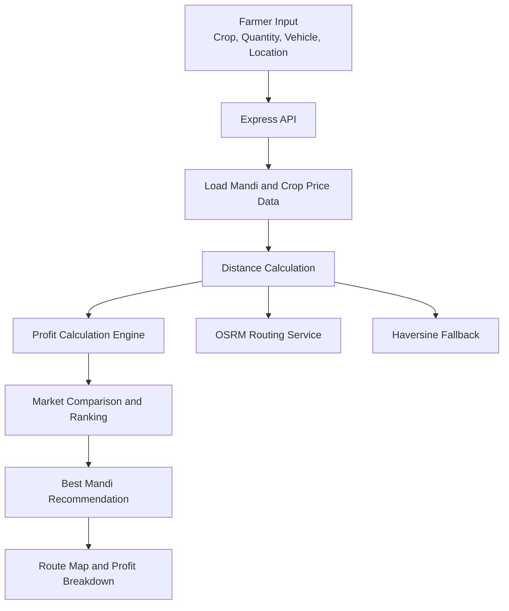

# 🌾 Krishi-Route

**A Smart Agricultural Market and Logistics Profit Optimizer**

Krishi-Route is an AgriTech platform that helps farmers identify the most profitable mandi (market) for selling their crops. It compares crop prices, transportation expenses, handling costs, and route distances to recommend markets based on estimated net profit rather than distance alone.

## 🚀 Features

- Compare multiple mandis based on expected net profit.
- Calculate transportation costs using vehicle-specific rates.
- Estimate revenue, expenses, and net profit.
- Display market routes using interactive maps.
- Use OSRM for road-distance and route information.
- Fall back to Haversine distance when routing is unavailable.
- Load mandi and crop-price information from local JSON datasets.
- Support an optional external market-price feed.

## 🏗️ System Architecture



## 🛠️ Tech Stack

| Category | Technologies |
|---|---|
| Backend | Node.js, Express.js |
| Frontend | HTML, CSS, JavaScript, React |
| Mapping | Leaflet.js, OpenStreetMap |
| Routing | OSRM |
| Data Storage | JSON datasets |
| Utilities | Axios, CORS, Native Fetch API |

## 📂 Project Structure

```text
krishi-route/
│
├── config/
├── data/
│   ├── mandis.json
│   └── prices.json
│
├── public/
├── src/
├── tests/
│
├── server.js
├── package.json
├── package-lock.json
├── index.html
└── README.md
```

## ⚙️ Installation and Setup

### 1. Clone the repository

```bash
git clone https://github.com/Chethan13032005/krishi-route.git
cd krishi-route
```

### 2. Install dependencies

```bash
npm install
```

### 3. Start the application

```bash
npm start
```

### 4. Open in browser

```text
http://localhost:5000
```

## 📡 API Endpoints

| Method | Endpoint | Description |
|---|---|---|
| POST | `/calculate-profit` | Calculates and ranks mandi profitability |
| GET | `/api/crops` | Returns available crops |
| GET | `/api/markets` | Returns mandi information |
| GET | `/health` | Checks server status |

### Profit Calculation

The application estimates profitability using:

```text
Revenue = Market Price × Quantity

Transport Cost = Distance × Vehicle Rate

Total Cost = Transport Cost
           + Loading Cost
           + Unloading Cost
           + Handling Cost

Net Profit = Revenue - Total Cost
```

## 📸 Project Screenshots

<p align="center">
  
</p>

<p align="center">
  
</p>

## 🌱 Future Enhancements

- Integration with live agricultural market price APIs.
- AI-based crop price prediction.
- Weather-aware mandi recommendations.
- Multilingual support for regional farmers.
- Mobile-friendly farmer dashboard.

## 📌 Project Status

**MVP – Minimum Viable Product**

Krishi-Route is a project focused on simplifying mandi selection through profit comparison and logistics calculations. It can be extended with real-time agricultural data and additional farmer-focused services.


[GitHub](https://github.com/Chethan13032005)
