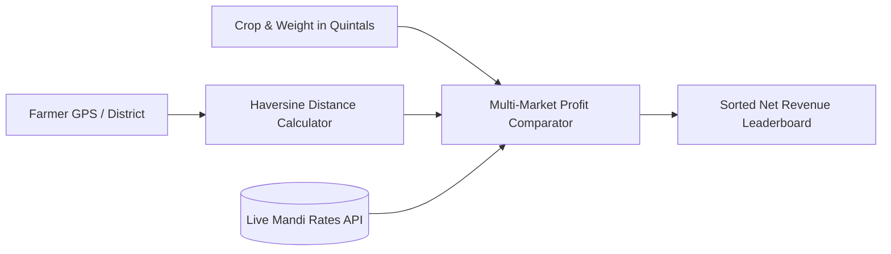

# 🌾 Krishi-Route

**Krishi-Route** is an AgriTech platform designed to help farmers choose the most profitable mandi (market) for selling their crops. Instead of selecting the nearest market, the platform compares crop prices, transportation expenses, and handling costs to recommend the option that delivers the highest net profit.

---

## 🚀 Features

* Compare multiple nearby mandis based on profitability
* Calculate transportation costs using route distance
* Estimate net profit after logistics and handling expenses
* Visualize routes on an interactive map
* Rank markets based on expected earnings
* Support local crop price datasets
* Optional integration with live market price feeds
* Automatic fallback distance calculation when routing services are unavailable

---

## 🎯 Problem Statement

Many farmers sell their produce at the nearest mandi without considering differences in market prices and transportation costs. As a result, they may miss opportunities to earn higher profits.

**Krishi-Route answers a simple but important question:**

> **Which mandi will give the highest profit after all costs are considered?**

The platform evaluates multiple markets and recommends the best destination based on actual profit rather than distance alone.

---

## 🏗️ System Architecture

```text
Farmer Input
      │
      ▼
Profit Calculation Engine
      │
      ├── Crop Prices
      ├── Market Locations
      ├── Transport Cost
      └── Handling Charges
      │
      ▼
Market Ranking Engine
      │
      ▼
Best Mandi Recommendation
      │
      ▼
Route Map + Profit Breakdown
```

---

## 🛠️ Tech Stack

### Backend

* Node.js
* Express.js
* CORS
* Native Fetch API
* fs/promises

### Frontend

* HTML5
* CSS3
* JavaScript
* React (CDN-based)
* Babel

### Mapping & Routing

* Leaflet.js
* OpenStreetMap
* OSRM Routing Service

### Data Storage

* JSON-based mandi datasets
* JSON-based crop price datasets

---

## 📂 Project Structure

```text
krishi-route/
│
├── data/
│   ├── mandis.json
│   └── prices.json
│
├── public/
│   └── index.html
│
├── src/
│   ├── components/
│   └── frontend files
│
├── server.js
├── package.json
└── README.md
```

> The application is served through `public/index.html` and managed by the Express backend.

---

## 📡 API Endpoints

### POST `/calculate-profit`

Calculates profitability across available mandis and returns ranked recommendations.

#### Sample Request

```json
{
  "crop": "onion",
  "quantity": 10,
  "quantity_unit": "ton",
  "vehicle_type": "tractor",
  "user_lat": 28.61,
  "user_lon": 77.21,
  "loading_cost": 0,
  "unloading_cost": 0,
  "handling_cost": 0
}
```

#### Response Includes

* Ranked mandi recommendations
* Revenue estimates
* Distance calculations
* Transportation costs
* Total expenses
* Net profit
* Route geometry for the best market

### GET `/api/crops`

Returns the list of available crops.

### GET `/api/markets`

Returns mandi locations and metadata.

### GET `/health`

Health check endpoint.

---

## 📈 Profit Calculation

```text
Revenue = Market Price × Quantity

Transport Cost = Distance × Vehicle Rate

Total Cost =
Transport Cost +
Loading Cost +
Unloading Cost +
Handling Cost

Net Profit =
Revenue − Total Cost
```

All quantities are automatically converted into tons before calculations are performed.

---

## 📍 Distance Calculation

### Primary Method

* OSRM Routing Service
* Real road-network distance

### Fallback Method

* Haversine Formula
* Straight-line geographic distance

This ensures reliable results even when routing services are unavailable.

---

## 📊 Data Sources

### Local Dataset

``

* Market information
* Coordinates
* Market identifiers

``

* Crop prices
* Market-wise pricing data

### Optional Live Feed

If configured, the application can fetch live market prices using:

```env
MARKET_PRICE_FEED_URL
```

---

## ⚙️ Installation & Setup

### Clone the Repository

```bash
git clone https://github.com/your-username/krishi-route.git
cd krishi-route
```

### Install Dependencies

```bash
npm install
```

### Start the Server

```bash
npm start
```

### Open the Application

```text
http://localhost:5000
```

---

## 🔧 Environment Variables

| Variable              | Description                   |
| --------------------- | ----------------------------- |
| PORT                  | Server port (Default: 5000)   |
| MARKET_PRICE_FEED_URL | Optional live crop price feed |

---

## 🌱 Future Enhancements

* Live Agmarknet integration
* AI-based price prediction
* Weather-aware market recommendations
* Multilingual support (Kannada, Hindi, Marathi)
* Farmer advisory chatbot
* Blockchain-based crop traceability
* Mobile application

---

## 📌 Project Status

**Current Version:** MVP (Minimum Viable Product)

This project was built for learning, demonstration, and portfolio purposes. It can be further enhanced with live agricultural market APIs, predictive analytics, and advanced decision-support features.

---

## 👨‍💻 Author

**Chethan A.**

BE Student • Full Stack Developer • Hobby project

Passionate about building technology solutions that create real-world impact in agriculture and society.

---

## 📸 Project Screenshots

 


## Krishi-Route Architecture



### Agricultural Logistics & Toll Waiver Verification
Farmers possessing a valid Mandi Gate Pass or state Farmer ID (`FID-KA-*`) receive automated toll exemptions in route profit simulations.


### API Quick Reference: Mandi Directory
```http
GET /api/mandis?district=Davanagere HTTP/1.1
Host: localhost:3000
```


## Sample Profit Simulation Walkthrough

Suppose a farmer in Chitradurga harvests **50 Quintals of Maize**:
1. **Local Mandi (Chitradurga APMC)**: 15 km away, rate Rs 2,050/quintal.
   - Gross: Rs 1,02,500 | Transport: Rs 360 | Cess: Rs 1,537 | **Net: Rs 1,00,603**
2. **Regional Hub (Davanagere APMC)**: 70 km away, rate Rs 2,280/quintal.
   - Gross: Rs 1,14,000 | Transport: Rs 1,680 | Cess: Rs 1,710 | **Net: Rs 1,10,610**
3. **Net Profit Advantage**: **+Rs 10,007** by transporting to Davanagere despite transport costs.
